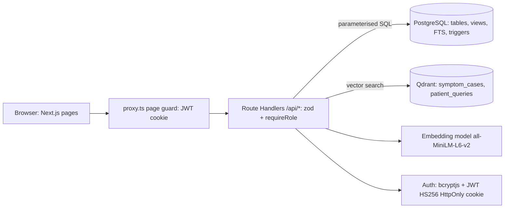
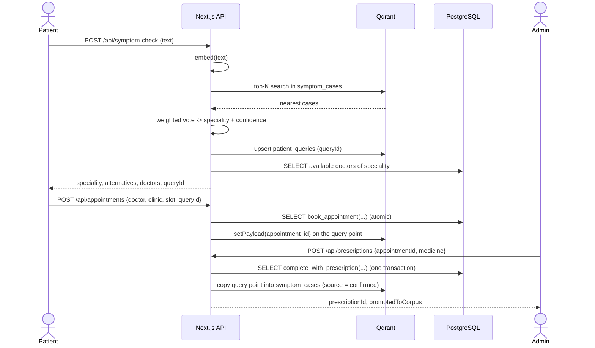

# 11. System architecture

Editable diagram: `docs/diagrams/architecture.drawio`.

## Sequence: symptom check -> book -> complete -> feedback

## Layers
* **UI:** React client pages call only the JSON API; server components read the session for navigation.
* **API:** one Route Handler per resource; each starts with `requireRole(...)`; input validated with zod; errors mapped centrally (`lib/errors.ts`).
* **Data:** `lib/data/*` and `lib/admin/*` hold all SQL (parameterised); `lib/vector/*` holds all Qdrant access.
* **Security:** bcrypt (cost 10), JWT HS256 in an HttpOnly SameSite=Lax cookie (Secure in production), secrets only in environment variables, security headers in `next.config.ts`.
